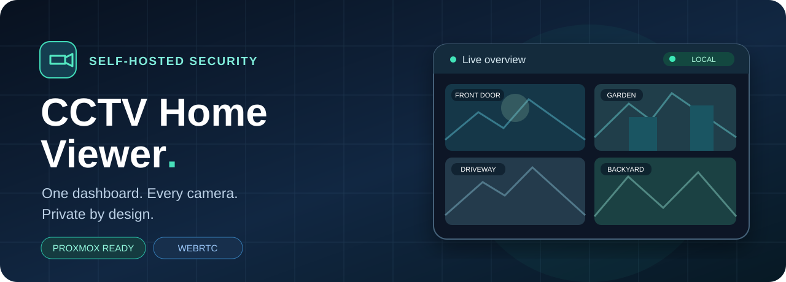
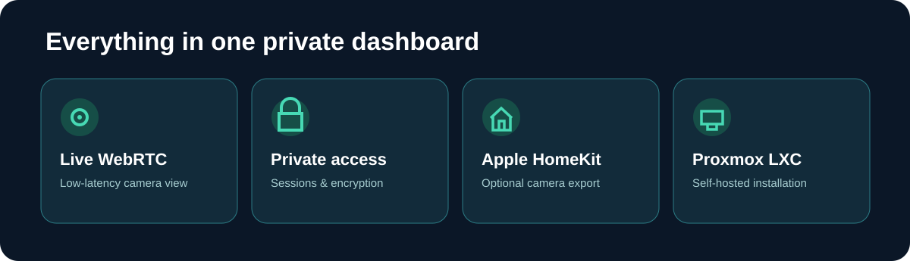
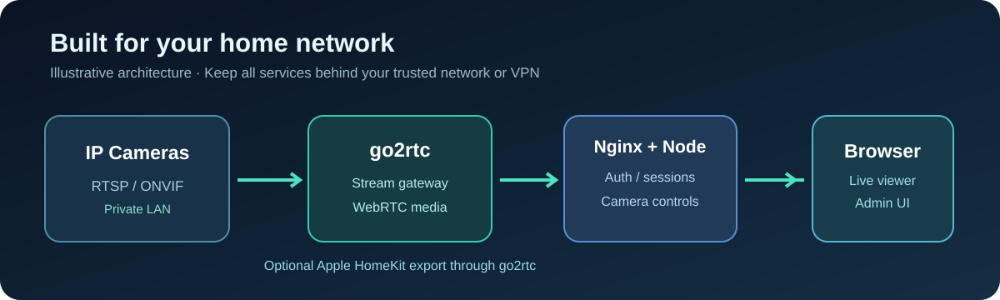

<div align="center">



# CCTV Home Viewer

**Private home camera dashboard · WebRTC · Proxmox LXC · Optional Apple HomeKit**

[](https://github.com/ThamerLab/CCTVHOMEVIWER/actions/workflows/ci.yml)  

</div>

> [!NOTE]
> The images below are **original vector illustrations**, not screenshots of real cameras or claims of tested streaming performance.



## Architecture at a glance



## Proxmox LXC

للتثبيت مباشرة داخل حاوية LXC غير مميزة وبدون Docker، شغّل الأمر التالي من Proxmox Shell كمستخدم `root`:

```bash
bash -c "$(curl -fsSL https://raw.githubusercontent.com/ThamerLab/CCTVHOMEVIWER/main/scripts/proxmox-lxc.sh)"
```

التخصيص، المنافذ، الصيانة والنسخ الاحتياطي موضحة في [LXC.md](LXC.md).

## الحماية

- تسجيل دخول إلزامي للمشاهدة والإدارة ومسارات WebRTC.
- جلسة عشوائية مخزنة على الخادم داخل Cookie من نوع `HttpOnly` و`SameSite=Strict`.
- حماية CSRF وتحقق من مصدر طلبات التعديل.
- تجزئة كلمة المرور باستخدام Scrypt.
- تشفير روابط الكاميرات على القرص باستخدام AES-256-GCM.
- منع إظهار رابط RTSP المحفوظ مرة أخرى في المتصفح.
- قفل تدريجي بعد محاولات الدخول الفاشلة.
- انتهاء الجلسة بالخمول ومدة قصوى مطلقة.
- قيود CSP ورؤوس حماية للمتصفح.
- واجهة go2rtc غير منشورة مباشرة، ولا يتم منح التطبيق Docker Socket.
- منع روابط loopback وخدمات metadata والعناوين العامة افتراضيًا للحد من SSRF.

## التشغيل الأول

1. ثبّت Docker وDocker Compose.
2. أنشئ ملف البيئة:

```powershell
Copy-Item .env.example .env
```

3. افتح `.env` وغيّر القيم التالية إلى أسرار طويلة ومختلفة:

```text
ADMIN_USERNAME=admin
ADMIN_PASSWORD=كلمة-مرور-طويلة-وعشوائية
DATA_ENCRYPTION_KEY=مفتاح-آخر-عشوائي-بطول-32-حرفًا-على-الأقل
```

يمكن توليد أسرار عشوائية في PowerShell:

```powershell
[Convert]::ToBase64String([Security.Cryptography.RandomNumberGenerator]::GetBytes(48))
```

4. شغّل:

```powershell
docker compose up -d --build
```

5. افتح:

```text
http://IP-OF-DOCKER-SERVER:8080
```

بعد تسجيل الدخول افتح **لوحة التحكم** وأضف روابط الكاميرات.

## Apple HomeKit

تثبيت LXC يدعم تصدير الكاميرات إلى Apple HomeKit عبر go2rtc.

لترقية حاوية موجودة:

```bash
bash -c "$(curl -fsSL https://raw.githubusercontent.com/ThamerLab/CCTVHOMEVIWER/main/scripts/enable-homekit-lxc.sh)"
```

1. افتح لوحة التحكم.
2. عدّل الكاميرا أو أضف كاميرا جديدة.
3. فعّل خيار **تفعيل الظهور في Apple HomeKit**.
4. احفظ، ثم افتح صفحة **HomeKit** من الشريط العلوي.
5. امسح QR الخاص بالكاميرا من تطبيق Apple Home، أو استخدم الـ PIN الظاهر بجانبها.

المتطلبات:

- iPhone/iPad/Apple TV/HomePod على نفس الشبكة مع الحاوية.
- عمل mDNS/Bonjour بين جهاز Apple والحاوية.
- كاميرات HomeKit تدعم H264 للفيديو وOPUS للصوت عبر go2rtc.

لـ HomeKit Secure Video والتسجيل داخل iCloud تحتاج Apple Home Hub وخطة iCloud مناسبة. إذا كان هدفك HKSV كامل مع motion detection، Scrypted غالبًا أفضل كخدمة منفصلة.

بعد نجاح التشغيل الأول وإنشاء الحساب، يمكنك حذف سطر `ADMIN_PASSWORD` من `.env`. كلمة المرور المجزأة تبقى في Docker volume، ولن يحتاج التطبيق إلى قيمة التهيئة مرة أخرى.

افتراضيًا تقبل لوحة التحكم كاميرات الشبكات الخاصة فقط، مثل `192.168.x.x` و`10.x.x.x` وعناوين Tailscale. إذا كنت تحتاج مصدر بث بعنوان إنترنت عام، اضبط `ALLOW_PUBLIC_CAMERA_HOSTS=true` بعد تقييم المخاطر.

## HTTPS

عند الوصول من خارج الجهاز أو عبر شبكة غير موثوقة، ضع التطبيق خلف reverse proxy يستخدم HTTPS ثم اضبط:

```text
SECURE_COOKIES=true
```

لا تنشر الصفحة أو المنفذ `8555` على الإنترنت مباشرة. استخدم VPN مثل WireGuard أو Tailscale. HTTPS مطلوب لحماية كلمة المرور والجلسة أثناء النقل.

## النسخ الاحتياطي

البيانات محفوظة في Docker volume باسم `app_data`. احتفظ بنسخة من:

- Docker volume.
- قيمة `DATA_ENCRYPTION_KEY`.

فقدان مفتاح التشفير يعني عدم القدرة على قراءة روابط الكاميرات المحفوظة.

## الأوامر

```powershell
docker compose ps
docker compose logs -f app
docker compose logs -f go2rtc
docker compose down
```

## المنافذ

| المنفذ | الاستخدام |
|---|---|
| `8080/tcp` | الموقع وصفحات الإدارة |
| `8555/tcp` | وسائط WebRTC |
| `8555/udp` | وسائط WebRTC منخفضة التأخير |

## تحسينات الأمان والتحديث (أكتوبر 2026)

- تحديث LXC ينشئ نسخة احتياطية قبل استبدال الكود في `/var/backups/cctv-home-viewer/`، ويحافظ على إعدادات go2rtc الحية واقترانات HomeKit بدل استبدالها بالإعدادات الافتراضية.
- ترقية HomeKit تنشئ نسخة احتياطية أيضًا وتتوقف عند وجود مجلد بيانات غير متوقع بدل حذفه.
- إعداد Docker يدعم اختيار عنوان الاستماع بإعداد `WEB_BIND_IP` للموقع و`MEDIA_BIND_IP` لوسائط WebRTC. حدّد عنوان LAN الصحيح بدل `0.0.0.0` عند الحاجة، مع ضبط جدار ناري يسمح للأجهزة الموثوقة فقط.
- CI يفحص صياغة JavaScript وBash وإعداد Compose وقواعد حماية بيانات التحديث. راجع [نتائج الاختبارات](https://github.com/ThamerLab/CCTVHOMEVIWER/actions).
- راجع [SECURITY.md](SECURITY.md) و[CONTRIBUTING.md](CONTRIBUTING.md).

### الاسترجاع بعد تحديث LXC

قبل استرجاع البيانات، **خذ نسخة إضافية من الحالة الحالية وأوقف الخدمات**، ثم افحص محتويات الأرشيف بأمر `tar -tzf /var/backups/cctv-home-viewer/FILE.tar.gz`. الأرشيف يحتوي بيانات `cctv-home-viewer` و`go2rtc-cctv`، لكن **مفتاح التشفير** الموجود في `/etc/cctv-home-viewer.env` يحتاج نسخًا احتياطيًا مستقلًا. لا تستبدل المجلدات الحية دون التأكد من التوافق ومن سلامة النسخة الاحتياطية.

> [!NOTE]
> رسومات README المستقبلية يجب أن تكون لقطات حقيقية أو رسومات موسومة بأنها توضيحية. لا توجد صور لواجهة تشغيل حقيقية معتمدة حتى الآن. كذلك لم يُختبر تحديث هذه النسخة على كاميرات فعلية أو على Proxmox مباشر في هذه الجولة.
